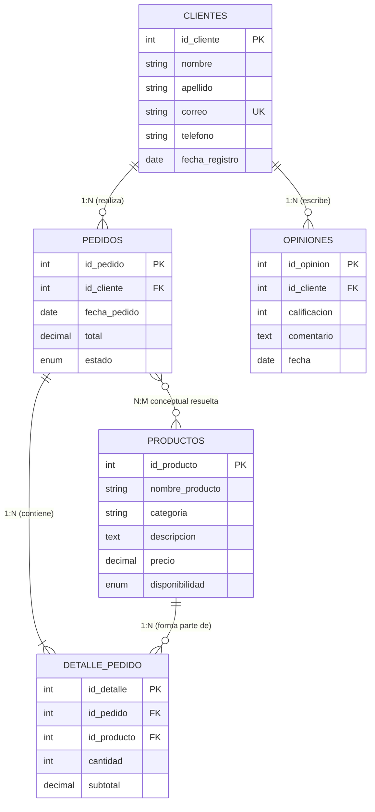

# PROYECTO PROM: PUNTO EXPRESO
## “El sabor que conecta” · Cafetería (Túquerres, Nariño)

**Institución Educativa:** Instituto Teresiano (Túquerres, Nariño)  
**Centro de Formación:** Centro Sur Colombiano de Logística Internacional  
**Programa de Formación:** Técnico en Programación de Software (Ficha 3212667)  
**Articulación:** Articulación con la Educación Media - Proyecto SENATIC / SENA  
**Fecha:** Octubre 2026 — Versión 1.0 Final  

### Equipo de Aprendices Participantes
- **Andrés Jacobo Yandar Termal** (ajacoboyanter@gmail.com · Cel: 3104440896)
- **Angie Tatiana Rosero Anama** (angie-roseroa@ieteresiano.edu.co · Cel: 3153276522)
- **Melany Silvana Tobar Burbano** (melany-tobaru@ieteresiano.edu.co · Cel: 3188803714)
- **Maicol David Díaz Tarapues** (maicol-diazt@ieteresiano.edu.co · Cel: 3184210112)
- **Alison Gabriela Pantoja Oviedo** (alison-pantojao@ieteresiano.edu.co · Cel: 3175498159)

### Equipo Evaluador y Dirección Académica
- **Instructor Responsable:** Darío Javier Vallejos Benavides (tatfija2023@gmail.com · Cel: 3168350454)
- **Rectora I.E.:** Fabiola del Rosario Caicedo López (insti.teresiano@hotmail.com · Cel: 3147077020)

---

## 1. Identidad Corporativa y Presentación de la Empresa

### 1.1 Información General
- **Razón Social:** Punto Expreso
- **Ubicación:** Túquerres, Nariño, Colombia
- **Sector Económico:** Sector Terciario (Servicios gastronómicos y cafetería de especialidad)
- **Slogan Principal:** *“El sabor que conecta”*
- **Lema Comercial:** *“Café · Calidad · Momentos”*

### 1.2 Misión
Brindar experiencias únicas a nuestros clientes mediante la oferta de café de alta calidad, productos de panadería y pastelería recién hechos, complementados con un servicio cálido, innovador y apoyado en herramientas tecnológicas que contribuyan al crecimiento del emprendimiento y al desarrollo de la comunidad del municipio de Túquerres.

### 1.3 Visión (2032)
Para el año 2032, ser una cafetería reconocida en el municipio de Túquerres y la región por la excelencia de nuestros productos, la calidad del servicio y la innovación tecnológica en nuestros procesos, consolidándonos como una empresa competitiva, sostenible y con proyección de expansión regional.

### 1.4 Valores Corporativos
1. **Calidad:** Ofrecemos productos frescos, ingredientes seleccionados y un servicio que supera las expectativas del cliente.
2. **Compromiso:** Trabajamos con responsabilidad y dedicación para garantizar la satisfacción de quienes confían en nosotros.
3. **Innovación:** Incorporamos soluciones tecnológicas, digitalización de pedidos y nuevas ideas para mejorar continuamente los procesos.
4. **Honestidad:** Actuamos con transparencia, ética y respeto en todas nuestras relaciones comerciales y personales.
5. **Trabajo en Equipo:** Valoramos la colaboración interdisciplinaria entre baristas, cocina y desarrolladores de software.
6. **Responsabilidad:** Administramos de manera eficiente los recursos y cumplimos los compromisos con clientes y proveedores.
7. **Pasión por el Café:** Promovemos la cultura cafetera nariñense de estricta altura, tradición y orgullo por lo nuestro.
8. **Orientación al Cliente:** Escuchamos las opiniones para brindar una atención cercana, oportuna y personalizada.

### 1.5 Organigrama Empresarial
- **Gerente General**
  - **Área Tecnológica:** Administrador Tecnológico / Desarrollador de la Página Web.
  - **Área de Producción:** Jefe de Cocina / Cocineros y Panaderos Auxiliares.
  - **Área de Servicio y Ventas:** Cajero / Barista Profesional / Atención al Cliente.

---

## 2. Análisis del Entorno y Matriz D.O.F.A.

| Factores Internos / Externos | Positivos | Negativos |
|---|---|---|
| **Factores Internos** | **FORTALEZAS**<br>• Amplio portafolio de café de especialidad, panadería, platos y combos infantiles.<br>• Atención ágil, cercana y personalizada.<br>• Plataforma web interactiva con base de datos MySQL.<br>• Equipo con competencias técnicas del SENA en desarrollo de software. | **DEBILIDADES**<br>• Marca nueva en etapa de introducción y reconocimiento.<br>• Recursos económicos iniciales limitados para grandes campañas publicitarias.<br>• Dependencia operativa de una sola sede física inicial.<br>• Necesidad de capacitación del personal en uso de herramientas web. |
| **Factores Externos** | **OPORTUNIDADES**<br>• Crecimiento del consumo de café especial en Túquerres.<br>• Transformación digital y adopción de compras por internet.<br>• Alianzas comerciales con caficultores y productores lecheros de Nariño.<br>• Fortalecimiento del turismo gastronómico en la región. | **AMENAZAS**<br>• Competencia con cafeterías y panaderías tradicionales de la zona.<br>• Alza en costos de insumos agrícolas y materias primas.<br>• Fluctuaciones en el poder adquisitivo de los consumidores.<br>• Condiciones climáticas de alta montaña que afecten la afluencia física. |

---

## 3. Portafolio de Productos y Servicios

Los precios y productos base solicitados en el proyecto junto con la propuesta de ingredientes y costos:

| ID | Producto | Categoría | Ingredientes / Detalle | Precio (COP) | Estado |
|---|---|---|---|---|---|
| 1 | Café Americano | Café | Café espresso nariñense, agua purificada caliente | $5.000 | Disponible |
| 2 | Latte | Café | Café espresso, leche vaporizada, microespuma suave | $7.000 | Disponible |
| 3 | Panadería Tradicional | Panadería | Harina de trigo, masa madre, mantequilla de campo | $4.000 | Disponible |
| 4 | Pastelería de Autor | Pastelería | Harina seleccionada, cacao, huevos frescos, azúcar | $6.000 | Disponible |
| 5 | Café Especial | Café | Grano de altura de Nariño, notas aromáticas cítricas | $5.000 | Disponible |
| 6 | Cappuccino | Café | Espresso concentrado, leche vaporizada, espuma densa | $7.000 | Disponible |
| 7 | Café con Leche | Café | Café tradicional recién filtrado, leche caliente | $6.000 | Disponible |
| 8 | Chocolate Caliente | Bebidas | Chocolate artesanal puro de campo batido con leche | $7.000 | Disponible |
| 9 | Té Gourmet | Bebidas | Infusión de frutos rojos y hojas aromáticas | $5.000 | Disponible |
| 10 | Pan Artesanal | Panadería | Hogaza campesina crujiente horneada al amanecer | $4.000 | Disponible |
| 11 | Croissant de Mantequilla | Panadería | Hojaldre francés crujiente con mantequilla pura | $6.000 | Disponible |
| 12 | Pan de Queso | Panadería | Almidón de yuca, queso campesino fresco rallado | $5.000 | Disponible |
| 13 | Torta de Chocolate | Pastelería | Bizcocho húmedo de cacao con ganache oscuro | $8.000 | Disponible |
| 14 | Cheesecake de Frutos Rojos | Pastelería | Queso crema sobre galleta crocante y salsa de mora | $9.000 | Disponible |
| 15 | Torta de Vainilla | Pastelería | Esponjoso bizcochuelo aromatizado con vainilla | $8.000 | Disponible |
| 16 | Desayuno Punto | Platos | Huevos al gusto, pan artesanal, queso, fruta y café | $12.000 | Disponible |
| 17 | Almuerzo del Día | Platos | Arroz, proteína seleccionada, ensalada fresca y sopa | $16.000 | Disponible |
| 18 | Cena Punto | Platos | Proteína ligera, vegetales al vapor y bebida tibia | $16.000 | Disponible |
| 19 | Hamburguesa Punto | Comidas rápidas | Carne artesanal 150g, pan brioche, queso y vegetales | $16.000 | Disponible |
| 20 | Sandwich Especial | Comidas rápidas | Pan baguette tostado, jamón curado, queso y aderezos | $12.000 | Disponible |
| 21 | Papas Fritas Crocantes | Comidas rápidas | Papa sabanera de Túquerres cortada y frita con sal marina | $8.000 | Disponible |
| 22 | Combo Infantil 1 | Combos infantiles | Mini sandwich de jamón y queso + jugo natural + galleta | $10.000 | Disponible |
| 23 | Combo Infantil 2 | Combos infantiles | Papas fritas doradas + nuggets de pollo + jugo o malteada | $12.000 | Disponible |
| 24 | Combo Infantil 3 | Combos infantiles | Mini hamburguesa + papas crocantes + jugo + porción torta | $15.000 | Disponible |

---

## 4. Estrategia de Redes Sociales y Presencia Digital

*(Propuesta demostrativa académica para Punto Expreso)*

### 4.1 Canales Seleccionados
1. **Instagram (`@puntoexpreso`):** 
   - Publicación de fotografías de alta definición de las bebidas y arte latte.
   - Anuncio de novedades y platos del día en historias fijadas.
   - Concursos y menciones de clientes disfrutando sus momentos de café.
2. **Facebook (`/PuntoExpresoTuquerres`):**
   - Difusión de noticias de la cafetería, eventos comunitarios y promociones familiares.
   - Canal de atención directa por mensajes para reservas y consultas.
   - Integración con el catálogo para pedidos rápidos.
3. **TikTok (`@puntoexpreso_oficial`):**
   - Videos cortos y dinámicos sobre preparación de bebidas y técnicas de barismo.
   - Recorridos por la cocina y el proceso de horneado matutino.
   - Contenido entretenido y de tendencias enfocado en la juventud de Túquerres.

---

## 5. Diseño e Ingeniería de la Base de Datos Relacional

La base de datos relacional `punto_expreso_db` se modeló para garantizar la persistencia de los procesos del negocio.

### 5.1 Diccionario de Tablas

#### Tabla 1: `clientes`
- `id_cliente` (INT, PK, AUTO_INCREMENT): Clave primaria del cliente.
- `nombre` (VARCHAR(50), NOT NULL): Nombres del cliente.
- `apellido` (VARCHAR(50), NOT NULL): Apellidos del cliente.
- `correo` (VARCHAR(100), NOT NULL, UNIQUE): Correo electrónico del cliente.
- `telefono` (VARCHAR(20), NOT NULL): Teléfono de contacto.
- `fecha_registro` (DATE, NOT NULL, DEFAULT CURRENT_DATE): Fecha de alta en el sistema.

#### Tabla 2: `productos`
- `id_producto` (INT, PK, AUTO_INCREMENT): Clave primaria del producto.
- `nombre_producto` (VARCHAR(100), NOT NULL): Nombre comercial.
- `categoria` (VARCHAR(50), NOT NULL): Categoría del menú.
- `descripcion` (TEXT, NULL): Características del producto.
- `precio` (DECIMAL(10,2), NOT NULL): Precio de venta unitario.
- `disponibilidad` (ENUM('Disponible', 'Agotado'), DEFAULT 'Disponible').

#### Tabla 3: `pedidos`
- `id_pedido` (INT, PK, AUTO_INCREMENT): Clave primaria de la orden.
- `id_cliente` (INT, FK, NOT NULL): Referencia a `clientes.id_cliente`.
- `fecha_pedido` (DATE, NOT NULL, DEFAULT CURRENT_DATE): Fecha del pedido.
- `total` (DECIMAL(10,2), NOT NULL, DEFAULT 0.00): Valor total de la orden.
- `estado` (ENUM('Pendiente', 'En preparación', 'Entregado', 'Cancelado')).

#### Tabla 4: `detalle_pedido` (Tabla Intermedia N:M)
- `id_detalle` (INT, PK, AUTO_INCREMENT): Clave primaria del renglón de detalle.
- `id_pedido` (INT, FK, NOT NULL): Referencia a `pedidos.id_pedido` (ON DELETE CASCADE).
- `id_producto` (INT, FK, NOT NULL): Referencia a `productos.id_producto`.
- `cantidad` (INT, NOT NULL, CHECK > 0): Unidades pedidas.
- `subtotal` (DECIMAL(10,2), NOT NULL): Importe parcial (precio × cantidad).

#### Tabla 5: `opiniones`
- `id_opinion` (INT, PK, AUTO_INCREMENT): Clave primaria de la reseña.
- `id_cliente` (INT, FK, NOT NULL): Referencia a `clientes.id_cliente`.
- `calificacion` (INT, NOT NULL, CHECK 1 a 5): Puntuación en estrellas.
- `comentario` (TEXT, NOT NULL): Reseña escrita.
- `fecha` (DATE, NOT NULL, DEFAULT CURRENT_DATE): Fecha de publicación.

---

## 6. Relaciones y Cardinalidad



### Justificación de Cardinalidad:
1. **CLIENTES ➔ PEDIDOS (1:N):** Un cliente puede registrar múltiples pedidos; cada pedido corresponde exactamente a un cliente.
2. **PEDIDOS ➔ DETALLE_PEDIDO (1:N):** Cada orden se desglosa en uno o varios detalles de productos; cada detalle se vincula a su orden padre.
3. **PRODUCTOS ➔ DETALLE_PEDIDO (1:N):** Un producto del menú puede ser incluido en múltiples pedidos; cada línea de detalle referencia a un solo producto.
4. **PEDIDOS ⮂ PRODUCTOS (N:M):** Relación resuelta mediante la tabla intermedia `detalle_pedido`.
5. **CLIENTES ➔ OPINIONES (1:N):** Un cliente puede aportar diversas valoraciones en el sitio web.

---

## 7. Integración de la Página Web con la Base de Datos

```
[Usuario] 
   ⬇ (Ingresa datos en formulario)
[Página Web HTML5 / CSS3] 
   ⬇ (Captura evento y valida campos)
[JavaScript / Fetch API] 
   ⬇ (Petición HTTP POST JSON / Form)
[Backend PHP (api.php)] 
   ⬇ (Valida y procesa sentencia preparada PDO)
[Base de Datos MySQL (InnoDB)] 
   ⬇ (Inserta o consulta registros)
[Respuesta JSON / Estado] 
   ⬇ (Retorna confirmación)
[Actualización Reactiva de la Interfaz Web]
```

### Módulos Integrados y Probados:
1. **Registro de Clientes:** Formulario reactivo con validación de correo y teléfono, almacenamiento directo y actualización instantánea en la tabla visual de clientes.
2. **Consulta de Clientes:** Tabla dinámica con filtrado y selector directo para asignar compras.
3. **Catálogo de Productos Dinámico:** Carga desde el modelo de datos organizado por pestañas de categorías.
4. **Simulador de Pedidos con Detalle:** Selección de cliente, adición de productos con cantidad, cálculo de subtotal y total, e inserción atómica en `pedidos` y `detalle_pedido`.
5. **Registro de Opiniones y Reseñas:** Formulario de calificación con estrellas y texto que se publica en el muro de clientes y en la tabla de opiniones.
6. **Explorador de Tablas de Base de Datos:** Panel en vivo que permite inspeccionar los registros de las 5 tablas relacionales para auditar las claves primarias y foráneas.

---

## 8. Guía de Ejecución y Pruebas del Proyecto

### Opción A: Prueba Rápida en el Navegador (Modo Híbrido Autónomo)
1. Abrir directamente el archivo `punto_expreso.html` con cualquier navegador (Chrome, Edge, Firefox).
2. El sistema inicializa una base de datos reactiva local con datos de prueba reales precargados.
3. Podrá registrar nuevos clientes, armar pedidos, calcular totales, enviar opiniones y consultar las 5 tablas sin necesidad de configurar servidores.

### Opción B: Ejecución con Servidor Local XAMPP (MySQL + PHP)
1. Iniciar la aplicación **XAMPP Control Panel** e iniciar los módulos **Apache** y **MySQL**.
2. Abrir phpMyAdmin en el navegador (`http://localhost/phpmyadmin`).
3. Crear o importar el archivo `database.sql` en phpMyAdmin.
4. Copiar los archivos del proyecto (`punto_expreso.html`, `PROM-Punto-Expreso.html`, `database.sql`, `conexion.php`, `api.php`) a la carpeta `C:\xampp\htdocs\punto_expreso\`.
5. Abrir en el navegador: `http://localhost/punto_expreso/punto_expreso.html`.
6. La página detectará el backend PHP y ejecutará las consultas directamente sobre MySQL.

---

## 9. Conclusiones

El proyecto productivo **Punto Expreso** cumple cabalmente con todos los requerimientos de la formación técnica en programación de software del SENA y la articulación con el Instituto Teresiano:
- Diseño visual moderno, responsivo y adaptado a la identidad cafetera de Túquerres.
- Estructura de base de datos relacional en 3FN con claves primarias y foráneas debidamente definidas.
- Integración funcional probada de registro, almacenamiento, consulta, pedidos y opiniones.
- Documentación completa lista para sustentación y evaluación ante el comité académico.
